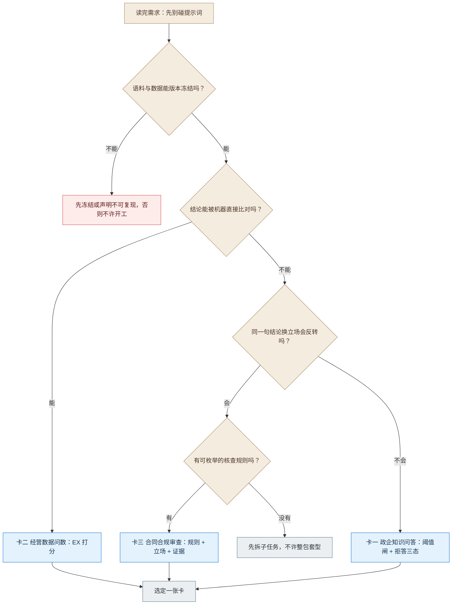
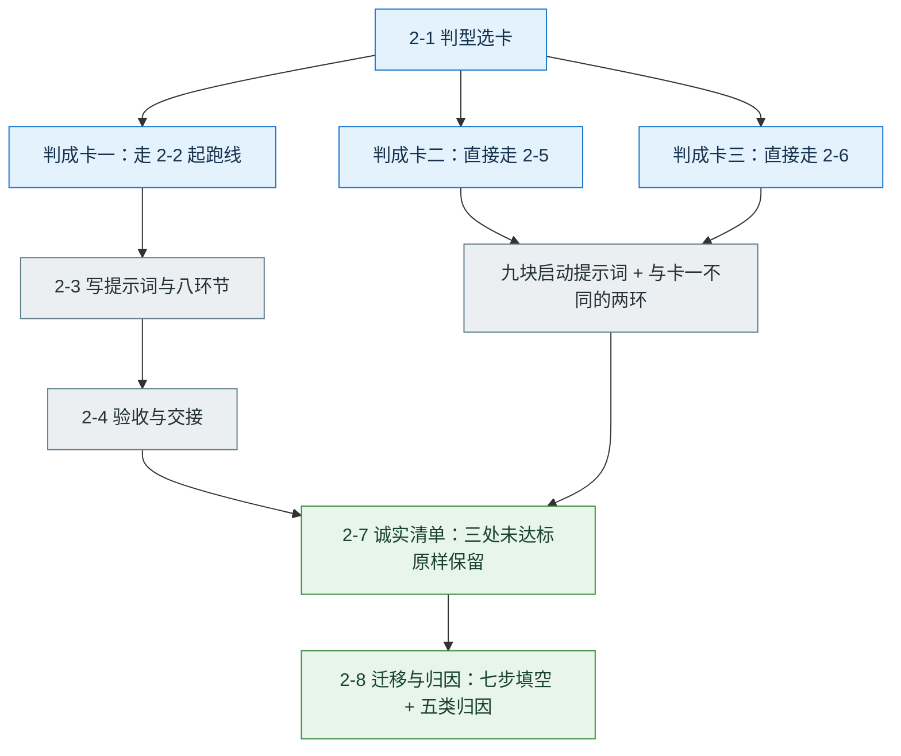
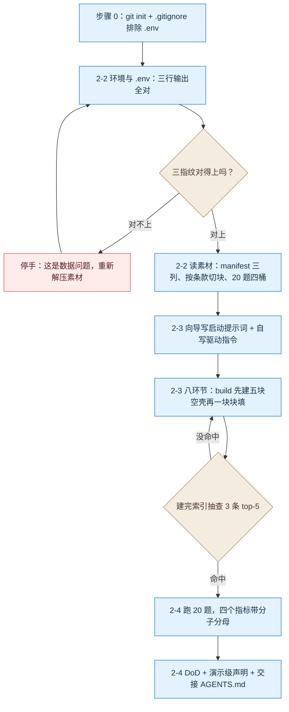

---

# 第二篇：做一个 AI 应用

**这一篇练什么判断：** 换一个陌生场景时，先判型、再定口径，然后才知道该把闸放在哪——而不是上来就选模型、抄方案。

**你要交什么：** 五件产物（见 2-4 末尾）。**卡一 RAG 要真做出来**，卡二卡三只做迁移对照。

## 本篇怎么排

**三张卡都有完整入口，但只精做一个。** 2-2 到 2-4 按卡一写；判成卡二或卡三的，走完 2-1 后直接跳到 2-5 或 2-6，那两节各含自己的环境初始化、九块启动提示词、与卡一不同的两环。

| 节 | 时长 | 做什么 | 这一节结束时你手上有什么 |
|---|---|---|---|
| 2-1 | 20′ | 判型选卡（三张卡共用） | 一行判型结论 |
| 2-2 | 15′ | **卡一**起跑线：环境、key、三指纹、读素材 | 三行输出全对 + 素材清单 |
| 2-3 | 60′ | **卡一**：写提示词 + 走完八环节 | 八份环产物 + 一个能跑的系统 |
| 2-4 | 15′ | **卡一**验收：四指标 + DoD + 交接 | 验收报告 + 五件产物 |
| 2-5 | 60′ | **卡二**入口：环境 + 九块提示词 + 两环差异（判成卡二的人走这节，替代 2-2~2-4 的业务部分） | 与 2-4 同 |
| 2-6 | 60′ | **卡三**入口：同上（判成卡三的人走这节） | 与 2-4 同 |
| 2-7 | 10′ | 诚实清单：三处未达标 | 一句"我认可这个口径" |
| 2-8 | 课后 90′ | 三卡横向对照、七步填空、归因、红线 | 五件产物定稿 |

> **时长说明：** 单张卡实操约 90 分钟。这 90 分钟来自手册样章的节奏：5 + 8 + 15 + 45 + 15。加上判型与诚实清单，课堂约 120 分钟。时间不够就砍两处：判型压到 10 分钟，2-4 的交接留课后。
> **一条纪律：** 只精做一个场景。三张卡不并排做。

**判型怎么走到一张卡，如图 5-1 所示。**



*图 5-1：判型四问走到三张卡*

**读图：** 先过"能不能冻结"这道前置闸，再问结论能不能被机器比对。三条路只走一条，选定之后才允许动手。

---

## 2-1 判型：先分类，再选卡

**步骤：**

1. 回答下面四问，四问都答完再往下看。
2. 用组合表定位自己的约束类型。
3. 选定一张卡。本篇实操按**卡一**写；若判成卡二或卡三，走完 2-2 到 2-4 后，直接读 2-5 或 2-6 对应那一节。

**四问（场景判型卡）**

| # | 问 | 答 |
|---|---|---|
| 1 | 我要的结论（数字 / 判断 / 等级）能被机器比对吗？ | 能 / 部分 / 不能 |
| 2 | 手上有没有可枚举的规则清单（谁写的、能否冻结版本）？ | 有 / 无 |
| 3 | 同一句结论，换个立场会不会反转？ | 会 / 不会 |
| 4 | 语料与数据能不能版本冻结（重建可复现）？ | 能 / 不能 |

**组合表**

| 组合 | 约束类型 | 对应卡 | 主闸放哪 |
|---|---|---|---|
| 1 不能 + 2 无 + 3 不会 | 语义不可判定 | 卡一 政企知识问答 | 生成之前的阈值闸 |
| 1 能 + 3 不会 | 可自动判定 | 卡二 经营数据问数 | 五道闸：意图 + 表列白名单 + 只读 + 单语句 + LIMIT |
| 1 不能 + 2 有 + 3 会 | 规则约束 | 卡三 合同合规审查 | 立场声明 + 证据主题守备 |
| 1 部分（混合） | **先拆，不许整包套型** | — | 各子任务各设闸 |
| 4 = 不能 | 评测不可复现 | — | 先冻结或声明"不可复现"，否则不许开工 |

**第 2 问要澄清一句话：** "可枚举的规则清单"指**可逐条核查的规则**（例如合同审查那 27 条：缺保密条款、违约金比例不够……），**不是语料文档**。制度库是素材，不是规则清单，所以卡一这一问答**无**。

**两条红线**
1. **拆不开的混合型，禁止开工。** 先把每个结论逐条问"靠哪张表、哪段原文"，拆出子任务再回来判型。
2. **判错型的代价要能看见。** 把合同审查误判成"纯语义问答"，就是用模型当尺子、不要求原文证据，误报会堆到不可用——实测精确率掉到 51.79%，27 个误报里 20 个来自同一条规则。

**关注点：** 判型的产出是一句话，不是一张表：属于哪种类型、主闸放哪、主尺子是什么。场景选错，后面所有指标白算。

**打回：** "先判型，选不出来就去做可判定性预检，别急着挑提示词。"

**三条实操路径怎么分流，如图 5-3 所示。**



*图 5-3：三张卡的分流与收尾*

**读图：** 卡一走完整四节，卡二卡三走自己的入口节；三条路最后都汇到同一份诚实清单与同一套归因方法。

---

**卡一的完整路径，如图 5-2 所示。**



*图 5-2：卡一 RAG 从建仓库到交接的六段路径*

**读图：** 两个回退点最关键——三指纹不对就停手（那是数据问题），索引抽查没命中就回 `build` 环，别急着往下验收。

## 2-2 起跑线：环境、key、三指纹（15 分钟）

**这一节练什么判断：** 分清"环境没通"与"方法没对"。这三步不过，后面学到的全是错的。

### 步骤 0：先建仓库（2 分钟）

后面第 5 到第 8 环要靠 Git 才能验：review 要看真实 diff、ship 不能在主干上发、retro 的数字全部来自提交历史。**没有 Git，后四环直接停摆。**

```bash
# 把 starter-kit 复制成你的工程目录，在工程根执行
git init
printf '.env\ndata/index/\n.venv/\n__pycache__/\n' > .gitignore
git add -A
git commit -m "chore: 起点：素材与契约，未写实现"
```

**关注点：** `.env` 必须进 `.gitignore`——里面有你的 key。之后每完成一环提交一次，提交信息写清这一环做了什么。

### 步骤 1：环境与配置（5 分钟）

装依赖、配 `.env`。下面这段可以直接贴给编码智能体：

```text
先只做环境准备，不要写业务代码。

1. 建独立虚拟环境 .venv 并激活；按 requirements.txt 安装依赖（版本已锁，不要升级）。
2. 把 .env.example 复制成 .env，按下表写入配置（键名保持原样）：
   SILICONFLOW_BASE=https://api.siliconflow.cn/v1
   SILICONFLOW_KEY=<我稍后填，先留占位>
   MODEL_MAIN=deepseek-ai/DeepSeek-V3
   MODEL_JUDGE=Qwen/Qwen2.5-72B-Instruct
   EMBED_MODEL=Qwen/Qwen3-Embedding-4B
   EMBED_DIM=2560
   RERANK_MODEL=BAAI/bge-reranker-v2-m3
   TOP_K=5
   CANDIDATE_N=20
   MIN_RERANK_SCORE=0.30
   PORT=4180
3. 跑 python eval/check_starter.py，把完整输出贴给我。
4. 等我填好 SILICONFLOW_KEY 后，做三类模型连通自检（生成 / 嵌入 / 重排各一次），
   报告：嵌入返回维度、重排返回的两条分数、生成是否返回非空内容。
5. 每一步结束停下汇报。不要改 docs/制度库/ 与 eval/ 下的任何文件。
```

然后把 `.env` 里的 `SILICONFLOW_KEY` 换成你的 key（讲师统一发放或自备）。**只改这一行。**

### 步骤 2：看三行输出（对不上就停手）

| 看什么 | 合格 |
|---|---|
| `check_starter.py` 输出 | 全部 PASS（12 / 23489 / sha256 / 20 题） |
| 嵌入自检 | 返回维度 **2560**，与 `EMBED_DIM` 一致 |
| 重排自检 | 返回两条分数，量级在 0 到 1 之间 |

**三指纹（素材对不对，只看这几组值）**

| 项 | 期望 |
|---|---|
| 文档数 | **12** |
| 文件全文字符合计 | **23489**（按"换行统一为 LF 的全文"统计，也是 `check_starter.py` 的断言值；`manifest.json` 里的 `char_count` 是另一个口径，不必与它对齐） |
| `manifest.json` 的 sha256 | `094a3376591ce8d28ec9992cfd1c48813cac5807284ab5fcb18d06ea831b6822` |
| 评估集条数 | **20**（15 可答 + 5 应拒答） |

> **嵌入口径：** 默认用 Qwen3-Embedding-4B（**2560 维**），这样你看到的数字与教材、验收记录同源。若为降本换 bge-m3（1024 维），必须**全量重建索引**并同步改 `EMBED_DIM`——两套维度的向量不能混用。
> **断网或无额度时：** 建索引、生成、重排都会失败，检索可跑。这不是你的代码问题，先解决网络与额度。

### 步骤 3：读素材（8 分钟，别跳过）

1. `docs/制度库/manifest.json`：12 条记录，每条有 `doc_id` / `status`（现行 / 试行 / 已废止）/ `effective_date` / `char_count` / `sha256`。**这三列决定后面能不能判"时效"。**
2. 随便打开两份制度：确认正文按"第 X 条"编号——**这就是你切块的天然单位**。
3. `eval/starter_set.jsonl` 共 20 行，四桶各 5 题：`single_hop` / `multi_hop` / `conflict_or_stale` / `unanswerable`。重点看 `conflict_or_stale`——它考"两份制度打架 / 旧条款已废止"，是本场景最难的一类。

**关注点：**

1. 口径怎么算分看 `eval/README-口径.md`，**不要自己发明一套**。
2. 评估集字段要认清：`qid`、`split`、`answerable`、`expect_answer_points`（最小事实点，不是整段原文）、`expect_source`（file + clause）、`note`（含"什么情况算不合格"）。
3. 素材包**故意不给**实现代码、现成索引、现成评测器。给了你，就等于把"怎么做"这件事拿走了。

**打回：** "三指纹对不上就停手——那是数据问题，不是你的代码问题。"

---

## 2-3 写提示词，走完八环节（60 分钟）

**这一节练什么判断：** 每一环只做一件事——**让它交产物，你按判据验收**；不合格一句话打回，不要自己动手改。

### 步骤 1：写两段话：启动提示词 + 驱动指令（15 分钟）

**向导只产一段。** 打开 `03-向导样章-rag-prompt-wizard.html`，七步填完，它给你的是**启动提示词**（业务目标、素材、口径、红线）。**驱动指令要你自己写第二段**——两者混在一起，业务目标和流程纪律就会打架。

**驱动指令模板（照抄，只改尖括号里）**

```text
按 gstack 八环依次推进，顺序不可跳过、不可打乱：
第 1 环 /office-hours → 第 2 环 /spec → 第 3 环 /autoplan → 第 4 环 受控施工
→ 第 5 环 /review → 第 6 环 /qa → 第 7 环 /ship → 第 8 环 /retro。

每一环结束停下汇报：这一环做了什么、交了哪些文件、门禁结果是什么。
需要我拍板的地方，列 2 到 3 个选项和各自代价，等我选。
本轮目标：<一句话>；本轮不做：<不做清单>。
```

**体检只是格式检查，抓不到语义错误。** 向导的八项体检是关键词级检查，只查"有没有写到"，查不出"写得对不对"——实测它会放过"来源最好带一下"这种写法。所以下面两条必须你自己核：

- **"来源必须给"** 不能写成"最好带来源"——一字之差，验收时无法判定。
- **拒答三态必须写进契约**（答出 / 声明资料不足 / 拒答），只写"不要乱答"等于没约束。

**三条自查：**

- [ ] 写了素材指纹（12 份 / 23489 / sha256），并要求它先跑校验
- [ ] 写了双指标与"来源错算未达标"
- [ ] 写了"一环一停 + 拍板点列选项等我选"

### 步骤 2：注入，从第 1 环开始

两段一起贴进会话：**启动提示词在前，驱动指令在后**。工具只接受一条消息时，用一行分隔并写明"第二段是流程纪律，不是需求"。

### 步骤 3：八环节对照表（45 分钟，本实操核心）

**这八个名字的来源：** 它们来自 gstack 八环工作法。第 1、2、3、5、6、7、8 环有对应的斜杠命令（`/office-hours`、`/spec`、`/autoplan`、`/review`、`/qa`、`/ship`、`/retro`）；**第 4 环"受控施工"没有斜杠命令**，它是照 spec 手写加护栏的过程。看不到斜杠命令不是你的环境坏了。

| 环 | 教材对应 | 交互要点（你要它做什么） | 不合格就打回 |
|---|---|---|---|
| 第 1 环 `/office-hours` | 5.2.2 | 先问四条**业务取舍**（答错 vs 答不出哪个更不能接受、3 秒是否硬指标、多轮是否进验收、数据能否出域）；技术口径不给它决定 | 不做清单只写"暂不支持"，没有代价 |
| 第 2 环 `/spec` | 5.2.4 | 每条 AC 必须带**分母 / 判定方式 / 证据文件**；三态写进契约；出处字段定死 | 出现"准确率要高"这类不可判定句 |
| 第 3 环 `/autoplan` | 5.2.6 | 让它列**选项 + 利弊**，你选；选完把"为什么没选另一个"写进 `SPEC-决策记录.md` | 出现"你看着办"，或它替你选了 |
| 第 4 环 受控施工 | 5.2.3 / 5.2.5 | 先建空壳，再**一次填一块**；建完索引当场抽查 3 条 top-5 | 标题当正文入库；一次写完五块；跳过抽查 |
| 第 5 环 `/review` | 5.2.5 | 按"现象 → 哪一层 → 先看什么"归因，**不许一上来换模型** | 只报风格问题；P0/P1 没修 |
| 第 6 环 `/qa` | 5.2.4 | 跑 20 题，四个指标都要给**分子分母**；空返回判失败 | 只报一个总分；来源没单列 |
| 第 7 环 `/ship` | 反模式与红线 | 未达标进 Known issues；写演示级声明 | 出现"基本达标""阶段性达成" |
| 第 8 环 `/retro` | 5.2.5 | 归入五类之一 + "下一步只做一件事" | 摩擦写成"沟通不畅"这种没法行动的 |

**三个通用动作：**

- **看产物**：文件在不在、字段齐不齐、数字能不能对上——不看它说得多好。
- **打回**：一句话加依据（"AC 没有分母，按教材 5.2.4 补上"）。**改由它改，你只判。**
- **卡住**：换问法 → 缩小范围 → 降一级（先要判断再要方案）→ 换环重来。不要同一句提示词反复重试。

### 步骤 4：`build` 环怎么填（唯一需要展开的环）

**第一步不是写实现，是建空壳。** 空壳只要三件事：五块分工在、每块有明确输入输出、函数体是 `raise NotImplementedError`。

1. **空壳**：解析 / 索引 / 检索 / 生成 / 服务五块，先不写实现。
2. **先填检索 + 生成**：跑通"一条问题 → 一段原文 → 一个出处"，这是最小闭环，跑不通别往下走。
3. **再补解析 + 索引**：按条款切块、写 `meta.json`、建完索引**抽查 3 条 top-5**。
4. **最后服务**：接 HTTP + 流式 + 健康检查。
5. 每块做完做一次冒烟：**能跑 → 结果对 → 出处能回原文**。三步缺一不算完成。

**切块与索引的硬要求（来自契约）：**

- 每个切块至少带：`chunk_id`（建议 `文档号#序号`）、`doc_id`、`doc_title`、`clause_no`、`status`、`effective_date`、`text`（原文不得改写）。
- 索引元信息至少要有：`built_at`、`chunk_count`、`doc_count`、`embed_model`、`embed_dim`、`corpus_sha256`。
- **出处必须由代码从元数据生成**，不允许模型自己填文件名——模型会编；出处回不到原文的引用，不许输出。

**三个接口必须成立：**

1. **健康检查**能回答"索引就绪了吗"（切块数、维度、文档数）。
2. **问答接口**支持流式，最后一定有一个结束事件，带答案、出处列表、状态、耗时。
3. **轨迹接口**能按一次问答的 id 取回完整中间产物。

**三态不是布尔：** `answered` / `insufficient_disclosed`（声明资料不足）/ `refused`（拒答 + 理由）。拒绝只用 `true/false` 无法区分"我知道我不知道"和"我根本没找到"。
**八份环节产物（缺一份，就等于那一环没做）：**

| 环 | 产物 | 里面必须有什么 |
|---|---|---|
| 1 | `场景说明.md` | 谁用、解决什么、判型结论、不做清单 |
| 2 | `SPEC.md` | 每条 AC 带分母与判定方式、三态、出处字段 |
| 3 | `DECISIONS.md` | 四个拍板点选项，以及"为什么没选另一个" |
| 4 | `BUILD.md` | 五块分工、切块字段、索引元信息 |
| 5 | `review.md` | 修了什么、留了什么、为什么留 |
| 6 | `qa-report.md` | 四个指标的分子分母 |
| 7 | `VERSION` + `CHANGELOG.md` | 版本号与已知问题清单 |
| 8 | `retro.md` | 五类归因里的一类 + 下一步只做一件事 |

**评测器谁写：** 你自己写，放在 `eval/` 下。**别让智能体"顺手跑一下"就当验收。** 判官自检最小动作：拿 3 条已知答案的题喂判官，看它判得对不对；判错先修判官，别去改业务。

**`corpus_sha256` 是什么：** 建索引时对**语料内容**算的哈希，不是 `manifest.json` 这个文件本身的 sha256。用途只有一个——重建索引后一眼确认"还是不是同一份数据"。

### 步骤 5：卡住了先查这五条

| 现象 | 原因 | 处理 |
|---|---|---|
| `check_starter.py` 报字符数不符 | 文件被编辑器改过编码或换行 | 重新解压素材包，别自己修 |
| 嵌入维度与 `.env` 不一致 | 换了模型没改配置 | 改 `EMBED_DIM` 并**重建索引**（旧向量作废） |
| 所有问题都被拒答 | 阈值与分数不同量纲（重排降级成 RRF 分数） | 把降级分数归一化，别直接比 |
| 库里明明有，总说找不到 | 切块切断条款，或阈值过高 | 看 top-5 排名，调切块单位 |
| 有答案被拒、没答案硬答 | 只有软闸或只有硬闸 | 双闸都要有，且都要回填状态 |
| 引用指向不存在的条款 | 引用由模型自填 | 引用必须由代码从元数据生成 |

---

## 2-4 验收与交接（15 分钟）

**这一节练什么判断：** 判断"做出来了"和"能交待"的区别。

### 步骤 1：跑 20 题，四个指标都写分子分母

| 指标 | 怎么算 | 报什么 |
|---|---|---|
| 答案正确率 | 覆盖 `expect_answer_points` 的题数 / 15 | 分子分母 |
| 来源可追溯率 | 出处与 `expect_source` 一致（文件名 + 条款号归一化）/ 15 | **单列，不与正确率合并** |
| 拒答正确率 | 5 条应拒答题中正确拒答数 / 5（"明确拒答"与"声明资料不足"都算对，硬答才算错） | 单独一行 |
| 误拒率 | 15 条可答题中被误拒数 / 15 | 单独一行，不许藏进总分 |

**小样本预期：** 15 题时"≥90%"等于 14/15；5 题时等于 5/5。差一条不达标正常，**不要因此改指标**。

**"对"怎么判（20 题里有 10 条 `note` 是空的，别等它给答案）：**

1. 先看 `expect_answer_points`——答案覆盖这些最小事实点就算对，**20 题都有这个字段**。
2. `note` 有值时才作补充判据（它常写"什么情况算不合格"）。
3. 两者都没有的题，单独列成"判据未定义"，**不许自己放宽**去凑分。

### 步骤 2：DoD 逐项打勾

- [ ] 初始化那三步验收都过（素材指纹、嵌入维度、重排分数）
- [ ] 索引有 `meta.json`，字段齐（含 `corpus_sha256`）
- [ ] 八环节产物齐全，`SPEC-决策记录.md` 有四个拍板点及"没选另一个"的理由
- [ ] 20 题跑完，四个指标都有分子分母
- [ ] 抽查 3 条：出处能点回原文并定位到条款
- [ ] 三态在输出里有字段可查（不是布尔）
- [ ] `.env` 未入库；P0/P1 已修
- [ ] 报告里有未达标项与演示级声明

> **DoD 全绿不等于结论达标。** DoD 是"该交的都交了"，不是"数字好看"。我们这套跑完 DoD 也全绿，门禁结论仍是 INCOMPLETE（见 2-7）。

### 步骤 3：写演示级声明（照抄改数）

> 本项目使用 12 份合成制度 + 20 条验证题，属**演示级验收**——结论仅证明方案在给定素材与样本上可行，不宣称覆盖全部制度或达到生产可用。

### 步骤 4：交两件东西给下一轮

1. **`AGENTS.md`**：这个工程怎么跑（venv、索引路径、四个模型名、评估命令、出处字段口径）。
2. **最小工具契约：**

```text
search_doc
输入：question
输出：answer、evidence（file + clause）、status（三态）、elapsed_ms
约束：evidence 为空时 status 不能是 answered
```

**五件产物（本篇收卷）：**

| # | 产物 | 判据 |
|---|---|---|
| 1 | 口径一页纸 | 每条都有分母、测量方法、阈值 |
| 2 | 不做清单 | 每条都写了代价 |
| 3 | SPEC 要点 + 四类契约 | 每条 AC 有测量方式与证据文件路径 |
| 4 | 架构草图（一页） | 能说清"输入从哪进、结论怎么出、哪里是闸" |
| 5 | 复盘一句话 | 落在五类归因中的一类 + "下一步只做一件事" |

**交付与自检：**

- [ ] 系统能跑，健康检查能报"切块数 / 维度 / 文档数"
- [ ] 四个指标都写了分子分母，且来源与正确率**没有合并**
- [ ] 未达标项原样保留，没被改写成"达标"
- [ ] 出处能点回原文，且条款号做过归一化

---

## 2-5 卡二：经营数据问数（入口）

**这一节练什么判断：** 当对错能由机器判时，判断力不该花在选模型上，而该花在**分母、比对规则与安全边界**上。

**你要交什么：** 与卡一同样的五件产物，主尺子换成 EX。

### 步骤 1：环境初始化（可粘贴）

```text
先只做环境准备，不要写业务代码。

1. 建独立虚拟环境 .venv 并激活；按 requirements.txt 安装依赖（版本已锁，不要升级）。
2. 把 .env.example 复制成 .env，按下表写入配置（键名保持原样）：
   SILICONFLOW_BASE=https://api.siliconflow.cn/v1
   SILICONFLOW_KEY=<我稍后填，先留占位>
   MODEL_MAIN=deepseek-ai/DeepSeek-V3
   DB_PATH=db/aicoding.db
   MAX_ROWS=1000
   QUERY_TIMEOUT_S=10
   MAX_CORRECTION_ATTEMPTS=2
   PORT=4181
3. 跑 python eval/check_starter.py，把完整输出贴给我。
4. 等我填好 SILICONFLOW_KEY 后，做一次生成模型连通自检，报告是否返回非空内容。
5. 每一步结束停下汇报。不要改 db/ 与 eval/ 下的任何文件。
```

**通过标准三行：** `check_starter.py` 全 PASS；三个基准值 `541252.34` / `57` / `35`；生成模型返回非空。

**指纹（对不上就停手）**

| 项 | 期望 |
|---|---|
| 库 sha256 | 以 `d1f5872e` 开头 |
| 表与行数 | 6 表合计 **8584** 行（客户 303 / 产品 36 / 员工 40 / 订单 2000 / 工单 5000 / 账单 1205） |
| 三个基准值 | `541252.34` / `57` / `35` |
| 评估集 | 20 题：14 可答（六种 SQL 结构）+ 3 歧义 + 3 写操作 |

**库内的 10 类埋点不要"修掉"**（重复客户、地市名不统一、等级空值、退订后仍出账……）——那是考题，不是脏数据。

### 步骤 2：启动提示词（九块骨架）

| # | 块 | 这一段必须写清 | 缺了会怎样 |
|---|---|---|---|
| 1 | 背景与角色 | 给谁施工、使用者在算什么账 | 做成"通用 SQL 助手" |
| 2 | 一句话目标 | 中文进 → 可核对 SQL、结果集与图表建议；写操作拒绝；口径不清先反问 | 只出 SQL，不管能不能核对 |
| 3 | 输入输出 | `sql`、`columns/rows/row_count`、`chart`、`clarification`、`rejected{gate,reason}`、`metrics_used` | `clarification` 与 `rejected` 两个状态被吞掉 |
| 4 | 技术栈与参数 | SQLite **只读**连接（`mode=ro`）；`LIMIT 1000` 超出标 truncated；超时 10 秒；纠错不超过 2 次且每次重过白名单；表数不超过 3 | 用可写连接，LIMIT 与纠错次数全凭默认 |
| 5 | 语义层 | `semantic_layer.json` 至少覆盖 10 个概念（营收 / 实收 / 欠费 / 折扣后月费 / 在网 / 新增订单 / SLA 超时 / 近三个月 / 千兆专线 / 高优工单） | 同一概念两处定义，结果对不上 |
| 6 | 数据现状 | 6 表 8584 行、seed `20261020`、10 类埋点、账单须挂 `order_id` 才能对账 | 把考题当脏数据清洗掉 |
| 7 | 验收口径 | **EX**：结果集与标准一致 / 14；**执行失败算未通过、不剔出分母**；列数一致、列序与别名无关、有 ORDER BY 才校验前 N 行顺序、浮点容差 0.01、空集等于空集、多解 SQL 都接受 | 自己发明"算对"标准；把失败剔除出分母 |
| 8 | 红线与停止 | 红线：写操作一律拒绝且不执行；库只读；不许改 `db/` 与 `eval/`；截断必须显式标注；不许拿展示层截断后的数据判分。**停止条件：每环停下汇报；白名单范围、LIMIT、纠错次数、歧义分级四点先列选项等我拍板** | 写操作被静默改写成查询；你失去中途纠偏机会 |
| 9 | 环境 | 8 个变量；密钥只从 `.env` 读，不硬编码 | 密钥硬编码或进日志 |

**三处必须换成你自己项目的：** 客户与部门、数据现状（表数 / 行数 / 指纹）、验收口径（样本量与阈值——但分母与比对规则不许省）。

**三个最容易写错的：**

1. **"不要乱删"不是红线。** 要写"写操作一律拒绝且不执行"，并让闸落在数据库连接上。
2. **只写"准确率"没写 EX。** 必须写清分母、比对规则、"执行失败算未通过"。
3. **漏了歧义处理。** 别只写"问不准要反问"，要写 blocking / advisory 两级与各自触发条件。

### 步骤 3：与卡一不同的两环

| 环 | 卡二要额外做的 |
|---|---|
| 第 3 环 `/autoplan` | 四个拍板点必须先列选项等你选：白名单范围、LIMIT、纠错次数、歧义分级 |
| 第 6 环 `/qa` | 除 EX 外补三个辅助指标：可执行率（/14）、歧义识别率（/3，主动给口径选项才算对）、写操作拒绝（3/3） |

**关注点：** 卡一的失败多是"答错"，卡二的失败多是"越界"或"判错"。**先把闸和尺子定死，再谈生成质量。**

---

## 2-6 卡三：合同合规审查（入口）

**这一节练什么判断：** 主观判断也要有工程约束——立场、证据、分级三件事钉不死，系统就会变成误报机器。

**你要交什么：** 与卡一同样的五件产物，主尺子换成"判定单元 = 规则 × 合同"的成对指标。

### 步骤 1：环境初始化（可粘贴）

```text
先只做环境准备，不要写业务代码。

1. 建独立虚拟环境 .venv 并激活；按 requirements.txt 安装依赖（版本已锁，不要升级）。
2. 把 .env.example 复制成 .env，按下表写入配置（键名保持原样）：
   SILICONFLOW_BASE=https://api.siliconflow.cn/v1
   SILICONFLOW_KEY=<我稍后填，先留占位>
   MODEL_MAIN=deepseek-ai/DeepSeek-V3
   MODEL_JUDGE=Qwen/Qwen2.5-72B-Instruct
   CONTRACTS_DIR=materials/contracts
   RULES_PATH=rules/rules.yaml
   SEMANTIC_MAX_CHARS=6000
   SEMANTIC_RULES=R20,R21,R22,R23,R24,R25
   PORT=4182
3. 跑 python eval/check_starter.py，把完整输出贴给我。
4. 等我填好 SILICONFLOW_KEY 后，做一次生成模型连通自检，报告是否返回非空内容。
5. 每一步结束停下汇报。不要改 materials/、rules/、truth/ 下的任何文件。
```

**通过标准三行：** `check_starter.py` 全 PASS；合同内容指纹以 `7fd9a1f3` 开头；生成模型返回非空。

**指纹（对不上就停手）**

| 项 | 期望 |
|---|---|
| 合同 | 30 份（`CT001`–`CT030.docx`），内容指纹以 `7fd9a1f3` 开头 |
| 规则清单 | 27 条（21 条确定性 + 6 条语义 `R20`–`R25`），**含立场 stance** |
| 判定单元样本 | 60 条（存在型 30 / 缺失型 20 / 语义 10） |
| 人工锚点 | 20 条 |

**合同结构是"章 / 第 X 条 / 段"**，解析要按条切并保留段偏移——否则定位字段填不出来。

**样本口径（这条决定你的指标算不算得出来）：**

- 60 条判定单元**只覆盖 CT001–CT004 四份合同**，它是**评分器校准集**，不是全量评测集。
- 单元分布是**正例密集**的：**57 条 `present=true`（缺陷或缺失确实存在），只有 3 条对照单元**。所以在这 60 条上——**召回算得出来，精确率与误报率基本估不出来**。
- 正式评测的分母是**规则 × 合同 = 27 × 30 = 810 个判定单元**，要全量跑。只跑校准集时，报告必须写明"仅在校准集上评估，不含误报估计"。
- **禁止用不足 10 个对照的样本算出的精确率写进报告**；某项分母为 0 时写"不可判定"，不许写 100%。

### 步骤 2：启动提示词（九块骨架）

| # | 块 | 这一段必须写清 | 缺了会怎样 |
|---|---|---|---|
| 1 | 背景与角色 | 给谁审、谁在用结论（法务与采购经办人要能复核） | 做成"合同摘要"，不是按清单查风险 |
| 2 | 一句话目标 | 读 docx，按规则清单识别风险与缺失项，出分级报告，每条带原文证据与定位；**审查代表甲方（采购方）立场**；扫描件不在范围 | 不知道站哪一方，结论对谁有利说不清 |
| 3 | 输入输出 | `summary`、`findings[]`（rule_id、level、title、evidence、locator{para_idx, offset}、remediation）、`coverage`（rules_checked、not_detected、needs_human）、`review_id` | 三态与定位字段被吞掉，报告无法复核 |
| 4 | 技术栈与参数 | python-docx + PyYAML；**双引擎**：21 条确定性规则全交代码，只有 6 条语义交模型；语义分片不超过 `SEMANTIC_MAX_CHARS=6000`；强制 JSON；规则号白名单；空返回判失败 | 21 条也交给模型；整份合同一次塞入导致静默失声 |
| 5 | 立场 | 明确写"代表甲方（采购方）"，并写进规则文件顶部、语义提示词、报告首页三个落点 | 把"对甲方有利"的条款报成风险，误报堆到不可用 |
| 6 | 数据现状 | 30 份合成合同、规则 27 条含 stance、单元样本 60、锚点 20 | 改坏规则文件；找不到单元与锚点 |
| 7 | 验收口径 | **判定单元 = 规则 × 合同，不按合同计**；存在型报 P / R / F1，缺失型报 Recall，语义型 Recall 与 Precision **成对报**，等级一致率单独算；定位拆两个分母；关闭语义层时 6 条语义规则必须显式出现在 `not_detected` | 只报召回（最优策略变成全部报风险）；定位混分母 |
| 8 | 红线与停止 | 红线：不得编造规则或自创规则号；不得改 `materials/`、`rules/`、`truth/`；"未检出"不得写成"合规"；每条结论必须带原文证据与定位。**调用粒度：语义规则逐条调用，不得把 27 条规则一次性交给模型；分片要按"规则相关的条款窗口"合并，不能机械按条切——跨条款规则（如 R25）按单条切片会失效**。停止条件：每环停下汇报；规则来源、立场声明、证据粒度、语义层开关四点先列选项等我拍板 | 模型自创规则；未检出被写成合规；跨条款规则整类漏检 |
| 9 | 环境 | 9 个变量；密钥只从 `.env` 读 | 密钥硬编码；不知道分片上限 |

**三处必须换成你自己项目的：** 客户与部门、数据现状（合同量 / 规则条数 / 单元数）、验收口径（阈值与样本——**分类型与分母不许省**）。

**三个最容易写错的：**

1. **漏写立场。** 立场是审查的坐标系，要写清代表哪一方，并指明它进提示词、不进接口。
2. **只写召回。** 必须写"召回与精确率成对报"，否则最优策略是全部报风险。
3. **把"未检出"当"合规"。** 要写三态，并要求关闭语义层时显式列出未检出的规则号。

### 步骤 3：与卡一不同的两环

| 环 | 卡三要额外做的 |
|---|---|
| 第 3 环 `/autoplan` | 四个拍板点必须先列选项等你选：规则清单来源、立场声明、证据粒度、语义层开关 |
| 第 6 环 `/qa` | 按类型分报：存在型 P / R / F1、缺失型 Recall、语义型 Recall + Precision 成对、等级一致率单列、定位拆两个分母 |

**关注点：** 卡一靠"拒答"守边界，卡二靠"闸"守边界，卡三靠"立场加证据"守边界。三者都不是靠模型自觉。

---

## 2-7 诚实清单：三处未达标，一处都不许改写

| 场景 | 真实结果 | 为什么它不算失败 |
|---|---|---|
| 卡一 知识问答（以下三个数是我们项目的实测，样本更大且有判官锚点，**不是你的验收目标**；你的 20 题复现不出 3.85%） | 门禁结论是 **INCOMPLETE**：判官失败率 **3.85%** 超过 2% 阈值；正确率 68.00%（facts 口径）；TTFT p95 3195ms（客户原口径是"3 秒"，我们改写为 1000ms 门禁，仍差得远） | 判官本身不稳时，任何正确率都不可信。写"不可判定"比写漂亮数字诚实，也更有用 |
| 卡二 数据问数 | **EX 未达标** | 对错能机器判，没达标就是没达标。把"能跑通"写成"做对了"，是这类系统最常见的静默失败 |
| 卡三 合同审查 | 召回必须**与精确率成对报**；判型错时精确率掉到 51.79%，27 个误报里 20 个来自同一条规则 | 只报召回的话，最优策略立刻变成"全部报成风险"——召回 100%，精确率归零 |

**关注点：** 三条的共同点是数字不好看但都能解释。手册保留它们，因为"结果不漂亮的时候怎么写"才是这套方法真正要教的东西。

**打回：** "把'基本达标''阶段性达成''符合预期'删掉，写清未达标项与影响面。"

---

## 2-8 迁移与归因（课后 90 分钟）

### 步骤 1：把卡二卡三套过去（只读卡，不重做）

**卡二 经营数据问数**

| 栏 | 内容 |
|---|---|
| 约束类型 | 可自动判定 |
| 主闸 | 五道闸：意图闸、表列白名单、只读连接、单语句、LIMIT |
| 主尺子 | EX（执行结果集一致率） |
| 硬校验值（讲师侧对照） | 库校验全 PASS、明细合计 8584；三条基准问句首行首列 `541252.34` / `57` / `35` |
| 常见翻车 | 标准 SQL 字面比对（多解全判错）；展示层截断做评测；写"解析准确率" |

**卡三 合同合规审查**

| 栏 | 内容 |
|---|---|
| 约束类型 | 规则约束 |
| 主闸 | 双引擎（确定性规则交代码、语义规则交模型）+ 立场声明 + 证据门禁 |
| 主尺子 | 判定单元 = 对象 × 规则；精确率与召回**成对报** |
| 硬校验值（讲师侧对照） | 数据校验 10 行 PASS、810 判定单元；`CT001` 全 0、`CT003` 含 `R02` 与 `R19` |
| 常见翻车 | 不声明立场就开审；只报召回不报精确率；整份合同一次塞模型导致静默失声 |

**关注点：** 卡二与卡一的最大区别是"对错能由机器判"，评测器必须自己写、且先自检；卡三的最大区别是"结论会因立场反转"，立场必须写死在规则文件顶部。

**打回：** "照抄卡一的拒答逻辑去做卡二，会得到一堆误拒——先换主闸。"

### 步骤 2：七步填空，把自己的场景套出来

| # | 做什么 | 产出 |
|---|---|---|
| 1 | 写下一句客户原话，越口语越好 | 一句原话 |
| 2 | 跑 `G-P0` 把口语需求改成可判定口径 | 口径与"不可判定处" |
| 3 | 跑 `G-P1` 逼出不做清单 | 不做清单（每条带代价） |
| 4 | 跑 `G-P2` 写成 SPEC + 四类契约 | SPEC 与契约 |
| 5 | 跑 `G-P4` 做可判定性预检 | 三栏表（能答 / 不能答 / 需补数据） |
| 6 | 跑 `G-P6` 设计评测（含尺子自检） | 评测方案 |
| 7 | 跑 `G-P8` 复盘归因 | "下一步只做一件事" |

### 步骤 3：五类归因（按可掌控程度从高到低查）

| 类别 | 含义 | 典型证据 | 处置 |
|---|---|---|---|
| 尺子 | 测量方法错 | 判官截断、比对无容差、展示层数据进了评测 | 先修尺子，再看数字 |
| 题库 | 题目或标准答案错 | 标准答案多带列、题面没说排序、配额不足 | 补不变量断言 |
| 闸门 | 该拦没拦，或拦错 | 未登记表可查、写操作被解释成查询 | 白名单 + 默认拒绝 |
| 模型 | 能力不足 | 某一分桶持续偏低，且已排除上面三类 | 补示例、换模型、缩范围 |
| 环境 | 外部因素 | 共享网关排队导致延迟抖动 | 记录并声明，不当能力缺口 |

```text
本轮最贵的摩擦是 ______，它属于五类里的 ______，下一步只做一件事：______。
```

写不出这句话，说明归因没做完——**列表格不算归因，"下一步做什么"才算。**

### 步骤 4：三条红线自查

1. 未达标不许写成达标。
2. "未检出"不是"合规"。
3. 换分母不算提升。

这三条不是技术判断，是诚信判断——退一次，后面所有数字都不再有人信。

---

# 附录（只有空表与速查）

# 附录 4 三张场景差异卡（打印用）

## 卡一 政企知识问答（本篇实操）

| 栏 | 内容 |
|---|---|
| 约束类型 | 语义不可判定 |
| 主闸 | 生成之前的阈值闸：重排最高分低于 `MIN_RERANK_SCORE`（默认 0.30）直接拒答、不调模型；提示词层软闸说"资料不足" |
| 主尺子 | 正确率（分母拆"题"与"事实点"）+ 来源可追溯率 + 拒答正确率 + 误拒率，四项分开报 |
| 关键参数 | `EMBED_MODEL=Qwen/Qwen3-Embedding-4B`、`EMBED_DIM=2560`、`RERANK_MODEL=BAAI/bge-reranker-v2-m3`、`TOP_K=5`、`CANDIDATE_N=20`、`MIN_RERANK_SCORE=0.30`、`PORT=4180` |
| 素材指纹 | 文档 12 份、全文 23489 字符、`manifest.json` sha256 `094a3376…`、评估集 20 题（四桶各 5） |
| 常见翻车 | 分母写成"所有问题"；空返回当没问题；只有软闸或只有硬闸；引用由模型自填；判官输出上限不够导致空返回 |

## 卡二 经营数据问数

| 栏 | 内容 |
|---|---|
| 约束类型 | 可自动判定 |
| 主闸 | 五道闸：意图闸、表列白名单、只读连接、单语句、LIMIT |
| 主尺子 | EX（执行结果集一致率） |
| 硬校验值（讲师侧对照） | 库校验全 PASS、合计 8584；三值 `541252.34` / `57` / `35` |
| 常见翻车 | 标准 SQL 字面比对；展示层截断做评测；写"解析准确率" |

## 卡三 合同合规审查

| 栏 | 内容 |
|---|---|
| 约束类型 | 规则约束 |
| 主闸 | 双引擎（确定性规则交代码、语义规则交模型）+ 立场声明 + 证据门禁 |
| 主尺子 | 判定单元 = 对象 × 规则；精确率与召回成对报 |
| 硬校验值（讲师侧对照） | 10 行 PASS、810 判定单元；`CT001` 全 0、`CT003` 含 `R02` 与 `R19` |
| 常见翻车 | 不声明立场；只报召回；整份合同一次塞模型 |

> **硬校验值的口径：** 卡一的三指纹是学员 `starter-kit` 的真实值；卡二卡三那两组标了"讲师侧对照"，来自我们已跑通的项目。做迁移时以各自包 `eval/README-口径.md` 为准，**不要跨场景套用**。

# 附录 5 判型卡与七步填空（打印用）

## 判型卡四问

| # | 问 | 我的答案 |
|---|---|---|
| 1 | 结论（数字 / 判断 / 等级）能被机器比对吗？ | 能 / 部分 / 不能 |
| 2 | 有可枚举的规则清单吗（谁写的、能否冻结版本）？ | 有 / 无 |
| 3 | 同一句结论换个立场会不会反转？ | 会 / 不会 |
| 4 | 语料与数据能版本冻结（重建可复现）吗？ | 能 / 不能 |

```text
我属于 ________ 型；主闸放在 ________；主尺子是 ________；现在缺的支撑是 ________。
```

## 七步填空

| # | 步骤 | 我的产出 |
|---|---|---|
| 1 | 客户原话（越口语越好） | |
| 2 | `G-P0` → 口径与不可判定处 | |
| 3 | `G-P1` → 不做清单（每条带代价） | |
| 4 | `G-P2` → SPEC 与四类契约 | |
| 5 | `G-P4` → 可判定性三栏表 | |
| 6 | `G-P6` → 评测方案（含尺子自检） | |
| 7 | `G-P8` → 下一步只做一件事 | |

## 复盘一句话

```text
本轮最贵的摩擦是 ________，它属于五类里的 ________，下一步只做一件事：________。
```
