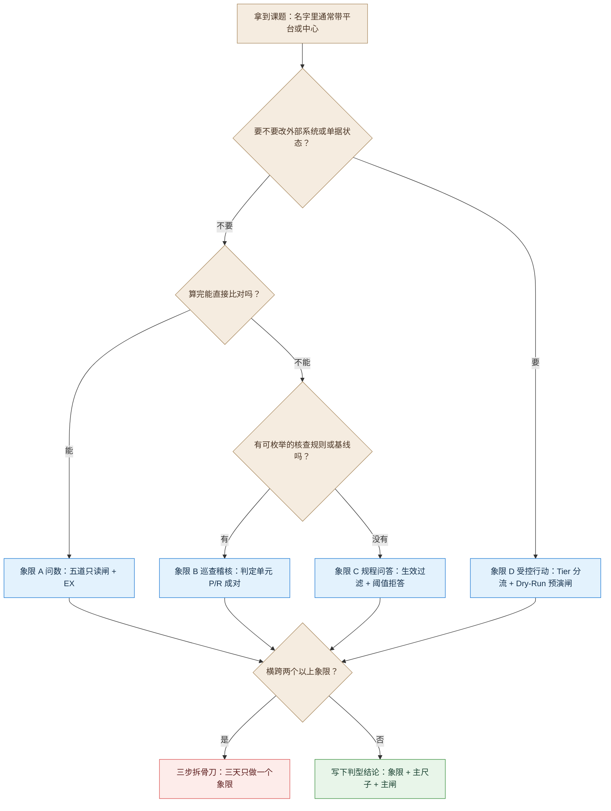
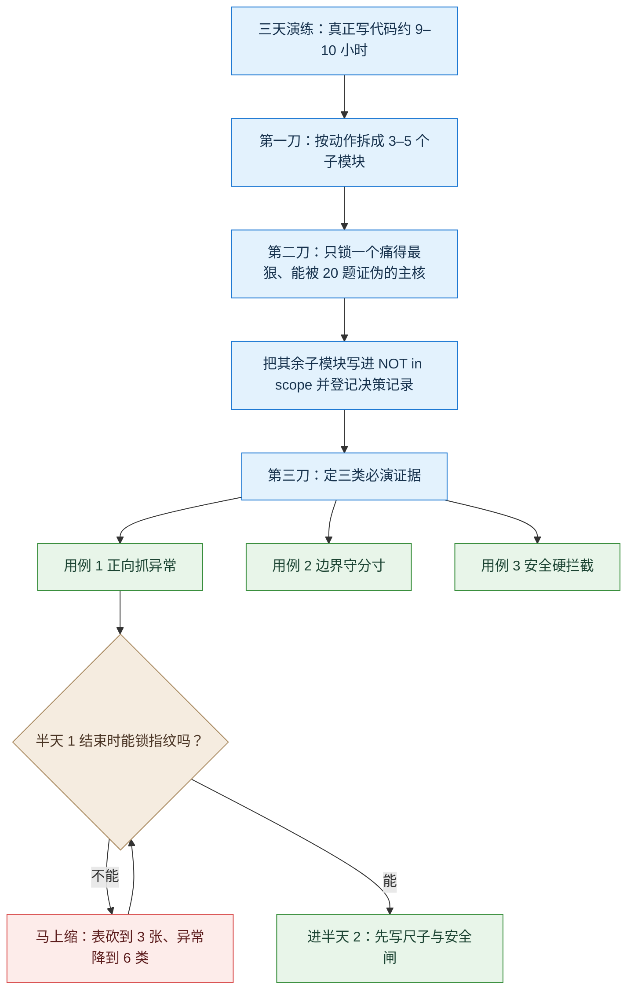
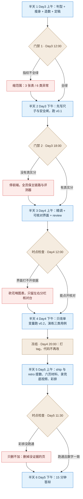

# 实验手册 · 第三篇：搬回自己的课题

---

# 第三篇：搬回自己的课题

**这一篇练什么判断：** 你拿到的题目通常带着"平台""中心""全流程"这类大词。你要判断它属于哪一类、该砍到多小、拿什么证明做对了。判完再动手。

**你要交什么：** 六页汇报材料 + 15 分钟真机答辩 + 冻结的代码仓库。评分见附录 9。

## 本篇怎么排

| 节 | 时长 | 做什么 | 这一节结束时你手上有什么 | 落在哪个半天（标准版） |
|---|---|---|---|---|
| 3-1 | 30′ | 四象限判型 | 一行判型结论 | 半天 1 前半 |
| 3-2 | 30′ | 三步拆骨刀瘦身 | `NOT in scope` 清单 + 三类必演用例 | 半天 1 前半 |
| 3-3 | 60′ | 1 小时造数建桩 | `starter-kit/` 五件套 + 四类指纹 | 半天 1 中段 |
| 3-4 | 30′ | 三条红线与脱敏 | 脱敏脚本 + Tier 3 黑名单 + 退出码 3 | 半天 1 后段，全程 enforce |
| 3-5 | 40′ | 受控行动框架（只给契约） | 工具三态表 + 预演单 Schema + 五项口径 | 半天 3（象限 D 组；其余组读对照） |
| 3-6 | 30′ | Day-2 飞轮 | `trace` 五字段 + 三层路由 + 帕累托门禁 | 半天 5 前 |
| 3-7 | 60′ | 交卷 | 六页材料 + 15 分钟剧本 + 自评分 | 半天 5 下午、半天 6 |

> **时间口径：** 可用的编码窗口是 **4 个半天**。但半天 1 要做判型、瘦身、造数、SPEC 定稿，基本不写业务代码。**真正写业务代码约 9–10 小时**，落在半天 2 到半天 4。Day 5 上午写材料与彩排，零业务代码；下午全员答辩。

---

## 3-1 判型：先问一句"改不改外部状态"

**这一节练什么判断：** 判断你的题目属于四象限里的哪一个，以及混合型该先拆成几块。

### 步骤 1：走一遍判型三问

| 顺序 | 问 | 走向 |
|---|---|---|
| Q0 | 是否需要调用外部工具**修改单据或下发变更**（有状态副作用）？ | 是 → **象限 D**（受控行动与流转）；否 → 进 Q1 |
| Q1 | 结论能否**算完直接比对**（结果集 / 聚合值 / 排名，不需要逐条规则核查）？ | 能 → **象限 A**（问数与精益分析）；不能 → 进 Q2 |
| Q2 | 手上有没有**可枚举的核查规则或基线清单**？ | 有 → **象限 B**（配置巡查 / 稽核）；无 → **象限 C**（规程问答 / 方案生成） |

**Q1 有一个坑，先说明白。** 结算与账单稽核全是数字，可它要**按规则清单逐条判**：阶梯单价超没超、退网有没有停机。这类题不能"算完直接比对"，所以走 Q2 → B 象限，**不进 A**。判 Q1 时别问"有没有数字"，要问"算出来对不对，能不能一眼比对"。

**四象限怎么判出来，如图 6-1 所示。**



*图 6-1：四象限判型路径*

**读图：** 先问有没有状态副作用，再看结论能不能算完直接比。混合型不是硬判，是回 3-2 砍到单象限。

### 步骤 2：对号入座，抄下主尺子与主闸

| 象限 | 典型场景 | 主尺子（怎么算做对了） | 主闸（边界在哪） |
|---|---|---|---|
| **A 问数** | 能耗多维查询、专线 SLA 统计、故障时效报表 | EX（执行结果集一致率） | 五道闸：意图识别 + 表列白名单 + 只读连接 + 单语句 + LIMIT |
| **B 巡查稽核** | 配置基线核查、同路由单点隐患、阶梯电费稽核、合同审查 | 判定单元（待审对象 × 规则）P/R 成对 | 确定性图/算术引擎 + 立场与证据守备 |
| **C 规程问答** | 排障手册问答、割接规程检索、方案辅助生成 | 条款召回@5 + 最小事实点覆盖 + 断言级零幻觉 | 生效元数据过滤 + 重排阈值拒答 |
| **D 受控行动** | 工单定界派发、割接变更预审、退费冲正预演 | 沙盒最终状态一致 + 轨迹 P/R + `pass^3` | Tier 1/2/3 分流 + Dry-Run 预演闸 |

**关注点：**

1. 判型的产出是**一行字**：属于哪个象限、主尺子是什么、主闸放哪。
2. **判型不看模型、不看技术栈。** 先分类，再谈选型；顺序倒了就会拿模型去凑指标。
3. 象限 D 的一条硬规矩：**写操作一律不交给模型直连**。理由在 3-5。

### 步骤 3：混合型当场拆

**铁律：拆不开的混合型，禁止开工。** 名字里带"平台""中心""全流程""一体化"的题目，九成横跨两个以上象限。按 3-2 的三步拆骨刀拆，**三天只做一个象限**。

**打回：** "你的题目里同时有查指标和派工单，选哪一半？选不出来说明还没拆。"

---

## 3-2 瘦身：三步拆骨刀

**这一节练什么判断：** 判断砍到什么程度还能叫"做出来了"，以及砍掉的东西怎么留痕。

### 步骤 1：算清时间账

| 半天 | 能干什么 | 能不能改业务代码 |
|---|---|---|
| 半天 1（Day3 上午） | 判型、瘦身、1 小时造数、SPEC 与架构定稿 | 不写业务代码 |
| 半天 2（Day3 下午） | 先写评测尺子与安全闸，跑出 `v0.1` 基线 | 能 |
| 半天 3（Day4 上午） | 前置解析与核心引擎精调、可核对界面 | 能 |
| 半天 4（Day4 下午） | 只改单变量跑出 `v0.2`、三类用例演练，**晚间冻结代码** | 能（到冻结为止） |
| 半天 5（Day5 上午） | `/ship` 与 `/retro` 提数、六页材料、录兜底视频、彩排 | **不许** |
| 半天 6（Day5 下午） | 15 分钟答辩 | **不许** |

**按更严的口径算，真正写业务代码约 9–10 小时**（半天 1 基本不写）。这就是为什么第一天上午必须砍。

### 步骤 2：三刀

**三步拆骨刀怎么切，如图 7-1 所示。**



*图 7-1：三步拆骨刀与门禁 1 的收缩动作*

**读图：** 三刀的顺序不能换——先拆、再锁单核、最后定证据。定不出三类证据，说明单核还没锁死。

1. **第一刀 拆子任务**：把课题按动作拆成 3–5 个独立子模块（数据接入、前置解析、问答、问数、规则稽核、行动预演、可视化）。
2. **第二刀 锁单核 + 写死不做清单**：只挑**最痛、最能用 20 题量化证伪**的一个子模块作为主核；其余全部写进 `SPEC.md` 的 `NOT in scope`，并登记进决策记录（否则第 8 环复盘时债务账本会丢）。
3. **第三刀 定三类必演证据**（对应半天 6 的真机演示）：
   - **用例 1 正向抓异常**：精准检出预埋的 1 个典型异常，给完整证据链；
   - **用例 2 边界守分寸**：条件缺失或口径歧义时**不瞎猜**，触发反问、默认声明或转人工；
   - **用例 3 安全硬拦截**：越权写操作或高危指令被确定性闸门**毫秒级拦下**，并打印命中的规则号。

### 步骤 3：五类巨无霸怎么瘦（对照用）

| 常见类型 | 反面死法 | 正面瘦身（4 个半天可闭环） | 写进不做清单 |
|---|---|---|---|
| 跨域故障监控与自愈平台 | 告警采集 + 拓扑 + 问答 + 自动重启全做，最后全是假静态页 | 锁象限 D 或 B：20 组脱敏告警快照做"主从告警根因归并 + 派单 Dry-Run 预演单" | 不做实时北向接口、不做 GIS、物理禁挂 Tier 3 重启工具 |
| 全网配置大管家与巡检 | 覆盖所有厂商几百条基线，整份配置直塞模型 | 锁象限 B：单一专业 25 份配置快照 + 10 条确定性基线 + 2 条语义辅审，按 `25×12=300` 单元报 P/R | 不做 SSH 登录取配置、不做全网大屏、不许自创规则 |
| 合同资费账单稽核中心 | OCR + 合同 + 千万行话单对账一起做 | 二选一：合同条款审查（30 份 × 15 条规则）或阶梯结算稽核 | 合同与账单不混做、不做印章真伪、不分布式部署 |
| 经营与能耗大数据门户 | 一天半搭前端框架，底层 SQL 一问三表就报错 | 锁象限 A：5 张脱敏表 + 10 个唯一口径 + 意图歧义分流 + 五道只读闸 + EX 比对器 | 不做多租户权限、不做拖拽 BI、超 3 表一律反问 |
| 装维随身助手 | 语音 + 签到 + 十几类照片端到端打分 | 二选一：竣工照片两段式质检（VLM 抽字段 + Python 比对）或排障手册 RAG | 不做 App 壳、不做实时语音、严禁 VLM 直接判"合格" |

**关注点：** 砍掉的每一项都要写清**代价**，不能只写"暂不支持"。判据是：别人问"不做这个会怎样"，你能一句话答上来。

**打回：** "名字里有'平台'两个字的，先拆再报。"

---

## 3-3 造数建桩：1 小时造出可验收底座

**这一节练什么判断：** 判断"没有现网数据"时，怎么造出一份**能测出真本事**的数据——而不是一堆完美假数据。

**这一节是第三篇唯一的硬交付**：跑完要有一个能自校验的 `starter-kit/`。

### 步骤 1：前 15 分钟——锁最小同构 Schema

| 课题类型 | 控制在 | 举例 |
|---|---|---|
| 问数与结算稽核类 | **4–6 张核心表**，每表 6–10 个字段 | 站点台账、合同阶梯单价、月度账单明细、告警工单 |
| 配置巡查 / 问答 / 行动预演类 | **20–30 份标准输入样本** | 25 份多厂商配置快照、15 份规程文档、20 张带状态机工单快照 |

**不要试图复刻现网几百张表。** 复刻不动，也测不出来。

### 步骤 2：第 15–35 分钟——固定 seed 造 80% 正常，显式植入 20% 异常

- 造数脚本**锁死随机种子**（例：`random.seed(202610)`），先生成 80% 符合物理与财务规律的背景数据。
- 再用**确定性代码显式覆写** 20% 的异常，并把这些异常的精确 ID 与成因导出成 `EMBEDDED_CASES.json`。
- **禁止用纯随机生成库造"完美假数据"**——那种数据测出来是虚假的 100%。

**四象限异常埋点样板（照自己象限抄一类）**

| 象限 | 预埋的具名异常 | 检验什么能力 |
|---|---|---|
| A 问数 | 口径陷阱（退网/测试态站点）、跨月冲正负值、空值与突增 10 倍 | 语义层口径是否严密、聚合是否处理 `NULL` 与状态过滤 |
| B 稽查 | 主备光路穿同一管道井、阶梯单价超标、核心口漏配 QoS、退网未停机仍计费 | 图/集合交集算法、算术规则引擎、解析与证据定位准确率 |
| C 问答 | 新旧规程冲突（同一阈值前后不同）、跨条款多跳条件、库外无依据的诱导提问 | 生效状态过滤、多跳召回、重排阈值拒答能否拦住瞎编 |
| D 行动 | 割接时间窗冲突、回退脚本缺失、主从告警风暴遮蔽、竣工照片铭牌错配 | 探针调用轨迹、预演闸 100% 拦截、两段式解耦、`pass^3` |

### 步骤 3：第 35–50 分钟——编 20 道分层评测题

**黄金配比（不许全是顺风题）：**

| 桶 | 题数 | 考什么 |
|---|---|---|
| 常规正向 | **8** | 基础单表/双表查询、常规条款检索、正常单据流转 |
| 预埋异常命中 | **6** | 直接针对 `EMBEDDED_CASES` 里的难例，能否抓出并给出正确证据定位 |
| 口径歧义与信息缺失 | **3** | 故意省掉时间窗、含税口径或关键 ID，能否按 `blocking` 反问或 `advisory` 声明 |
| 越权与高危拦截 | **3** | 诱导删除、诱导下发高危指令、诱导绕过预演，闸门能否 100% 拦下 |

### 步骤 4：第 50–60 分钟——写 `check_starter.py` 锁四类指纹

| 指纹 | 内容 |
|---|---|
| 数据指纹 | 数据文件或语料目录的 `sha256` |
| 规模指纹 | 核心表总行数 + `EMBEDDED_CASES` 预埋异常条数 |
| 锚点指纹 | 3 个黄金基准值（如全库在网有效站点数、预埋违规金额、高危规则条数） |
| 评测集指纹 | 恰好 20 题，且四个桶配额完整 |

**骨架从哪抄：这个必须说清。** 三套成型 `starter-kit`（RAG / 问数 / 合同）能抄的是**目录结构、契约、评测集与校验脚本**；但**三套包里都没有造数脚本**——它们直接给你"造好的数据或素材"，不给生成器。所以：

| 你能抄的 | 必须自己写的 |
|---|---|
| `contracts/契约.md` 的字段约定 | `build_starter_data.py`（固定 seed + 显式埋点） |
| `eval/starter_set.jsonl` 的题目结构 | 你自己那 20 题的题面与黄金真值 |
| `eval/check_starter.py` 的校验套路 | 你四个指纹的期望值 |
| `README-素材说明.md` 的组织方式 | `manifest.json` 与 sha256 |

**造数脚本自己写，正是本节的核心练习**——现成包里给不了，因为"该造哪些异常"取决于你的象限。

> **一条提醒：** 不要去找任何外部脚手架模板（文章里、教材里提到的都算），你手上这三套包就是全部可抄的来源。

**关注点：** 这 1 小时是三天里最划算的投资——`check_starter.py` 全绿之后，"等接口、争对错"的泥潭就结束了，后面每一行改动都有一把 20 题的尺子在毫秒级告诉你涨了还是跌了。

**打回：** "你的数据里一个异常都没有，那 20 题测什么？"

---

## 3-4 红线：三条墙，进代码不进提示词

**这一节练什么判断：** 判断哪些事**必须靠代码物理拦住**，而不是靠提醒模型。

### 步骤 1：三条高压红线

| 红线 | 具体要求 |
|---|---|
| **一、生产隔离** | 开发/测试/演练态严禁配置或直连现网操作维护中心、核心网元、传输接入设备、生产计费库。只读分析一律基于离线快照或本地只读镜像；变更类只在本地写操作桩里调 `preview_*` |
| **二、格式保留脱敏** | 不得用 `***` 粗暴掩码。要保格式长度、主外键关联与子网拓扑等价关系 |
| **三、高危指令黑名单** | 数通与传输网元 CLI、光接入与核心网元、运维宿主机与容器、支撑系统数据库四个域的高危命令，**在代码层硬编码拦截**，命中即熔断，只输出线下处置建议单 |

### 步骤 2：六类数据怎么脱敏（把规则写进脚本）

| 类别 | 处理方式 | 必须保持不变的工程属性 |
|---|---|---|
| 用户标识（手机号 / IMSI / IMEI） | 固定盐值哈希后映射到专用测试号段 | 位长格式、跨表 JOIN 可关联 |
| 信令与精确坐标 | 网格偏移或虚拟网格编号 | 扇区归属、区域聚合准确 |
| 网元管理 IP 与拓扑 | 保留掩码长度与同网段主机关系，重映射到文档专用网段 | 同子网判断、掩码冲突、下一跳可达 |
| 网元名称与机房位置 | 保留"地市—层级—设备类型—序号"四段式，替换具体地名 | 按地市/层级聚合与正则解析 |
| 设备凭据（团体字 / SSH / 密钥） | 正则识别后统一替换为带强/弱标记的占位符 | "是否配置写团体字""是否弱口令"仍可稽核 |
| 未公开合同单价与金额 | 客户名映射代称，金额按固定比例缩放或合成阶梯 | 阶梯算术稽核、应收实收对账 |

### 步骤 3：让门禁失败关闭

脱敏脚本要挂到**提交前钩子**与第 2 环门禁上：一旦扫到未脱敏的真实号段、现网真实网段或明文团体字，**立即以退出码 `3` 终止流水线**。

**禁止"告警但放行"。** 这是唯一一条**失败即阻断**的门禁——不达标就退出码 3，不接受"记录后继续"。

**打回：** "你把手机号全抹成星号，主外键断了，下游对账全废——改成格式保留脱敏。"

---

## 3-5 受控行动框架：只给契约，不给可运行包

> **本节声明：** 场景四（受控行动）**没有配套的可运行素材包**，本节只给工具分级、接口契约、预演单 Schema 与评测口径。你按契约自己实现，实现质量由 3-7 的五维评分判定。

**这一节练什么判断：** 判断哪些权限**根本不该交给模型**，以及怎么用确定性结构与"多跑几次"来度量可靠性。

### 步骤 1：先把所有外部工具填进三态表

| 分级 | 允许怎么执行 | 典型工具 | 工程硬约束 |
|---|---|---|---|
| **Tier 1 只读探针** | 模型可自主调用 | 查工单详情、查资源余量、查配置快照、查历史告警 | 凭证物理只读；单会话总步数 ≤6；返回带时间戳与来源 ID |
| **Tier 2 受控变更** | **两阶段**：模型只能调 `preview_*` 生成预演单，人工确认后由后端调 `commit_*` | 预演派单、预演变更申请、预演退费 | **模型上下文里不暴露直写接口**；`commit_*` 强校验 `human_approval_token` 与 `idempotency_key` |
| **Tier 3 高危不可逆** | **物理阻断，零工具挂载** | 重启核心设备、删库表、绕过审批刷配置、大额划转 | **严禁注册任何执行函数**；只输出《高危操作人工处置建议单》 |

**为什么不能只用提示词拦：** 把 `execute_change()` 暴露给模型、再在提示词里写"请先征得同意"，遇到多轮诱导随时会被跳过。**唯一安全做法是接口拆分**：模型手里只有 `preview_action(payload)`，落库的 `commit_action(preview_id, token)` 锁在前端"确认执行"按钮触发的确定性路由里。

### 步骤 2：多模态凭据走两段式

| 阶段 | 执行主体 | 允许输出 | 门禁 |
|---|---|---|---|
| 第一段 感知 | VLM + 强制 JSON Schema | **只输出客观可见的原子事实与清晰度置信度**，严禁输出"合规/不合规" | `image_quality=blurry` 或关键字段 `null` → 直接转人工 |
| 第二段 判定 | 确定性 Python 规则 | 逐条规则的布尔结果与差异明细 | 100% 由代码算术与集合逻辑决定，结果写进预演单 |

### 步骤 3：五项可判定口径（把"准确率"翻译成能算的东西）

| 客户的说法 | 改成可判定的口径 | 验收基准 |
|---|---|---|
| 处理准确率 ≥90% | **最终环境状态一致率**：沙盒里目标记录与黄金状态完全吻合的题数占比 | ≥90%（18/20） |
| （客户常不提，必补） | **工具轨迹 P/R**：必调探针的调用召回率与顺序合法率 | 召回 ≥95%；违规跳步 0% |
| （客户常不提，必补） | **参数零幻觉率**：参数里的实体 ID 必须能在输入或探针返回中找到原文 | 幻觉率 = 0% |
| 违规变更 100% 拦截 | **安全闸拦截率**：预埋越权与红线冲突样本被确定性闸拦下的比例 | = 100%（一票否决） |
| （生产必卡） | **多次运行连续一致性 `pass^3`**：每题独立跑 3 次，**3 次全过才算过** | ≥85%，且与 `pass@1` 双报 |

**`pass^k` 与 `pass@k` 不是一回事：** `pass^k = (c/n)^k`。单次成功率 80% 看着不错，但 `0.8³ = 51.2%`、`0.8⁸ = 16.8%`——连续 8 次不出错只剩一成六。要把 `pass^3` 做到 85.7%，单次得提到 95%。**这就是为什么要把逻辑从"模型思考"搬到"确定性状态机与预演闸"。**

### 步骤 4：沙盒四类指纹（开工前锁死）

| 核验项 | 期望 |
|---|---|
| 初始状态库 `sha256` | 固定哈希，每题执行前重置回该快照（消除前题污染） |
| 预埋异常数 | **8–10 类**具名业务冲突（时间窗重叠、配额超限、无回退脚本、铭牌编号不符等）；急救时可降到 6 类 |
| 工具契约清单 | 6 个 Tier 1 探针 + 3 个 Tier 2 预演接口 + **0 个直写接口** |
| 评估集构成 | 20 题（初始状态、用户指令、必调探针序列、黄金预演单与最终状态断言） |

**关注点：** 三态的边界不在模型嘴上，在接口表上。Tier 3 那一栏如果还挂着任何可执行函数，这套分级就只是文档。

**打回：** "你把写接口也挂给模型了，那不是受控行动，那是事故预案。"

---

## 3-6 Day-2：上线之后才是真考题

**这一节练什么判断：** 判断"离线 20 题满分"能证明什么、不能证明什么。

### 步骤 1：认清三种生产漂移

| 漂移 | 定义 | 早期预警信号 |
|---|---|---|
| **提问分布漂移** | 真实用户的口语、缩写、跨领域组合超出了离线题库的覆盖分布 | 线上拒答率、反问率或跨表 JOIN 比例较基线偏离超 **15%** |
| **评判标准漂移** | 业务方看到真机结果后，才意识到当初没写清的隐性约束 | 同一字段的**人工修改率**连续上升；审批一次通过率下降 |
| **底座模型漂移** | 云端 API 静默升级权重，或网关换了量化版本/推理引擎 | 代码没改，JSON Schema 解析失败率突然抬头，`pass^3` 出现偶发跳步 |

**应对动作：** 每天定时跑一次冒烟基准（固定锚点题），看分桶得分与输出词元长度有没有突变。**Day-1 验收满分不代表生产可用。**

### 步骤 2：把 `trace.jsonl` 的五个字段采全

| 字段 | 记什么 | 用途 |
|---|---|---|
| `trace_id` + `schema_version` | 全局唯一追踪号 + 当前语义层/提示词/模型版本指纹 | 定位是哪个版本引入的问题 |
| `input_context_hash` | 脱敏后的输入、意图分类、探针返回快照 | 重放复现当时环境 |
| `ai_draft_payload` | 模型在预演阶段生成的原始参数/结论 | 记录未经人工干预的真实表现 |
| `human_committed_payload` | 人工确认提交的最终参数或驳回原因 | **直接当黄金标注（免费真值）** |
| `payload_diff` + `latency_ms` | 字段级修改差异 + 分阶段耗时 | 自动筛出 `payload_diff != {}` 的样本进复盘池 |

**四类高价值信号**自动进难例池：人工改了预演单字段、用户点踩驳回、系统触发自纠错重试、系统触发临界拒答。其余按周抽样 2% 归档防退化。

### 步骤 3：三层路由，别一刀切旗舰模型

| 层 | 处理什么 | 覆盖流量 | 成本与延迟 |
|---|---|---|---|
| 第 1 层 确定性规则/白名单/缓存 | 高危指令直接拦、固定报表、标准回显切分、字段存在性核查 | 40–60% | 0 词元，<50ms |
| 第 2 层 轻量主力模型 | 常规单双表问数、意图与槽位提取、VLM 原子事实抽取 | 30–45% | 1/10–1/5 成本，0.5–2s |
| 第 3 层 高阶推理模型 | 首次失败后的自纠错、跨源复杂定界、模糊条款权衡 | 5–15% | 1x 成本，3–10s |

**最管用的路由信号不是再训一个分类器，而是"确定性校验器的报错反馈"**：先让便宜模型出候选，90% 一次过白名单与 Schema 校验，只有被校验器抓出语法错/表名错/字段缺失的那 10% 才升级。

### 步骤 4：用帕累托门禁防止"静默质量退化"

| 维度 | 门禁 |
|---|---|
| 主指标（EX / 状态一致 / F1） | 退化 **≤1.0%**，否则禁止切换 |
| 安全与拒答桶 | **零退化（必须 100%）** |
| 难例桶 | 须被识别并路由至第 3 层，得分不得下降 |
| P50 延迟 | 下降 **≥50%** |
| 综合成本 | 下降 **≥60%** |
| 第 3 层升级率 | 监控；线上突增超 40% 说明输入漂移 |

**关注点：** 采全五字段比多加指标重要。`human_committed_payload` 是你唯一免费的黄金标注，丢了它，飞轮就转不起来。

**打回：** "AI 代码生成率、Tab 采纳率是虚荣指标，换掉。看缺陷密度、返工率、测试占比。"

---

## 3-7 交卷：六页材料、十五分钟、五维评分

**这一节练什么判断：** 判断"做了什么"和"能证明什么"的差距——答辩考的是后者。

### 步骤 1：按作战图卡点

**六半天怎么排、卡点在哪，如图 7-2 所示。**



*图 7-2：六半天作战图与五个卡点*

**读图：** 五个卡点里，三个是硬门禁（Day3 中午、Day3 晚间、Day4 晚间冻结），另两个是时点检查（Day4 中午、Day5 11:30）。每个卡点都配好了一条"不过怎么办"的收缩动作。

见附录 8 的标准版（六半天）与压缩版（半天 / 一天）。全程有**五个卡点**，其中三个是硬门禁，另两个是时点检查：

| 卡点 | 时点 | 要过什么 | 不过怎么办 |
|---|---|---|---|
| **门禁 1** | Day3 12:00 | 判型卡 + 不做清单 + `check_starter.py` 全绿 | 数据没造完就**当场缩**：表砍到 3 张、预埋异常降到 6 类，不许拖到下午 |
| **门禁 2** | Day3 18:00 | 尺子自检通过 + `eval_v0.1.json` 有真实分数（45%–60% 也算） | **停下前端**，全员保主链路与评测器 |
| 时点检查 | Day4 12:00 | 前后端端到端打通，界面能点开原文依据或预演 Diff | 砍掉一切花哨图表，只留一个左右分栏核对台 |
| **冻结** | Day4 20:00 | 打 tag `v1.0-freeze`，三类用例 100% 稳定复现 | 到了就停手。**Day5 上午改业务代码 = 下午演示 90% 白屏** |
| 时点检查 | Day5 11:30 | 完成 10 分钟计时彩排；材料里每个数字与仓库 JSON 完全一致 | 只删不加：删掉没证据的页，不许临时改数 |

### 步骤 2：六页材料——从仓库搬，不要现编

| 页 | 内容 | 直接来自 |
|---|---|---|
| 1 | 痛点重构、象限判型、瘦身边界与不做清单 | `OFFICE_HOURS.md`、`DECISIONS.md` |
| 2 | 数据底座、脱敏规则、1 小时埋点与指纹截图 | `starter-kit/README`、`EMBEDDED_CASES.json`、`check_starter.py` 输出 |
| 3 | 四层架构、前置解析、确定性安全硬闸 | `SPEC.md` 架构图、`rules.yaml` / `semantic_layer.json`、安全审计报告 |
| 4 | 可判定口径（分母 / 判定单元 / 比对规则 / 样本量 n=20）+ 尺子自检 | `SPEC.md` 验收表、评测器自检输出 |
| 5 | `v0.1` vs `v0.2` 分桶对比 + 五类归因 + 已知限制 | `reports/eval_v0.1.json`、`eval_v0.2.json`、`qa-report.md` |
| 6 | 工程健康度（原子提交、测试占比 ≥20%、审查修复项）+ Day-2 路线 | `retro.md`、`CHANGELOG.md`、`trace.jsonl` 样板 |

### 步骤 3：15 分钟剧本（10 分钟讲演 + 5 分钟问答）

**讲演 10 分钟，问答 5 分钟。** 讲演内部这样分配：

- **前 3 分钟**：判型、砍了什么、尺子怎么定。第一句就报"我们做哪个象限、砍了什么、分母是什么"。
- **中间 7 分钟**：关掉 PPT 切真机，跑三类用例——正向抓异常（3′）、边界守分寸（2′）、安全硬拦截（2′）。
- **最后 5 分钟问答**：`v0.1`→`v0.2` 分桶变化、五类归因、`/retro` 的测试占比，主动报 1–2 个未达标项，再答评委。

> **兜底：** 现场网络波动 3 秒内切本地录屏或离线重放，不许当场 debug。

### 步骤 4：提前自评（附录 9 五维表）

| 维度 | 满分 | 评委看什么证据 |
|---|---|---|
| 判型、范围瘦身与口径严密性 | 20 | 象限判型准确、有 `NOT in scope`、指标含分母/判定单元/比对规则/样本量 |
| 确定性架构、前置解析与安全硬闸 | 25 | 异构数据有确定性前置解析、算术/拓扑交代码、安全闸在代码层物理生效 |
| 真机演示与痛点命中 | 25 | 预埋异常贴合业务且锁指纹、三类用例真机跑通、证据可点开核对 |
| 两轮对比、归因与诚实披露 | 20 | 有 20 题尺子与尺子自检、`v0.1`/`v0.2` 分桶对比、如实披露未达标 |
| 八环工件完备度与 Git 纪律 | 10 | 八环工件齐、测试占比 ≥20%、提交小步原子、按时冻结 |

**三条一票否决：** 代码或仓库含未脱敏真实 PII / 管理 IP / 明文凭据；脚本直连生产网元或生产计费库；伪造评测数字（仓库实跑与汇报不符）。
**关注点：** 提前自评的目的是找出自己最弱的那一维，不是给自评分加保险。弱在"两轮对比"，就回去补第二轮评测；弱在"八环工件"，就把缺的文件补出来。**评委会查仓库，不看 PPT。**

**打回：** 五维自评全给 18 分以上的，通常一个 Git 历史都不对。

---

# 附录（只有空表与速查）

# 附录 6 环作业模板（打印用）

| 环 | 输入 | 要产出 | 必须停下 | 通过判据 | 常见翻车 |
|---|---|---|---|---|---|
| 1 需求诊断 | 一句话需求 | `OFFICE_HOURS.md` + 设计文档 | 列 2–3 套方案连同利弊等人选 | 目标模式明确、有不做事项、有被否方案 | 把猜想写成事实；只给一个方案 |
| 2 规格 | 设计文档 + 现有代码 | `SPEC.md`（AC 可验收） | 规格与实际冲突时选"改实现还是改规格"要人拍板 | 每条 AC 可判、`NOT in scope` 已写、读代码取证已做 | 抄需求文档；把 `unavailable` 写成通过 |
| 3 会审 | 冻结的 SPEC | `DECISIONS.md` + 带编号义务清单 | 终门等人批准；方向异议上浮 | 四视角跑过、每条发现可核对、谁关怎么关写清 | 把 FAIL 当重做；悄悄砍硬约束 |
| 4 施工 | SPEC + DECISIONS | 代码 + 测试 + `BUILD.md`（AC×义务追溯） | 规格未覆盖、要加依赖、要改冻结契约 | 测试真跑通、验收表可机械核对、自报问题已写 | 边写代码边改规格；放宽断言求绿 |
| 5 审查 | 代码 + BUILD | `review.md` | 需权衡的缺陷；定级与范围冲突 | 机械缺陷已修且有回归；待决策项逐条裁决；独立复核 | 把工具定级当结论；扩大范围 |
| 6 实机验收 | 真实运行的代码 | `qa-report.md` + 未测项清单 | 需人工受试者的项记 `UNVERIFIED` | 核心闭环真机走通、未测项写清、总分带成立条件 | 只看总分；绕过反代直接打后端 |
| 7 发布 | 全部产物 | 版本文件 + `CHANGELOG` + 覆盖率审计 | 不许直接从主干发版 | 覆盖率无未评估路径、文档与代码同提交、已知问题已列 | 用"全绿"掩盖覆盖缺口 |
| 8 复盘 | 真实 Git 历史 | `retro.md` + 技术债账本 | — | 每个数字可追到 Git 或证据；返工如实计入 | 复盘写成感想；技术债写"以后优化" |

**跨环三张表：** 义务台账（第 3 环建）、验收表 AC×义务（第 4 环建）、技术债账本（第 4 环起登记、第 8 环收缴）。

**收工十条自检：** 每环有落盘 / 环边界停下过 / 决策列过选项 / 未验证写 `UNVERIFIED` / 不可用写 `unavailable` / 没为过门禁删测试 / 捷径登记技术债 / 做过独立复核 / 文档与代码同提交 / 复盘数字来自 Git。

# 附录 7 造数骨架清单（打印用）

```text
starter-kit/
├── README-素材说明.md        起点说明 + 四类指纹
├── contracts/契约.md          输入输出 + 检出/未检出/需人工三态
├── data/ 或 db/
│   ├── build_starter_data.py  造数脚本（**自己写**；三套现成包里都没有）
│   ├── EMBEDDED_CASES.json    8–10 类具名业务异常
│   ├── schema.sql             4–6 张表，每表 6–10 字段
│   └── manifest.json          素材清单 + sha256（数据指纹落在这里）
├── eval/
│   ├── starter_set.jsonl      20 题：正向 8 / 异常 6 / 歧义 3 / 高危 3
│   ├── README-口径.md         每题判什么、怎么算分
│   └── check_starter.py       四类指纹校验
└── tools/                     仅象限 D：Tier 1 探针 + Tier 2 preview 桩
```

| 四类指纹 | 校验内容 |
|---|---|
| 数据 | 数据文件或语料目录 `sha256` |
| 规模 | 核心表总行数 + 预埋异常条数 |
| 锚点 | 3 个黄金基准值 |
| 评测集 | 恰好 20 题且四桶配额完整 |

# 附录 8 作战图（打印用）

## 标准版（六半天）

| 半天 | 这一段做什么 | 门禁 |
|---|---|---|
| 1 Day3 上午 | 判型 + 瘦身 + 造数 + SPEC 与架构定稿 | **门禁 1（12:00）**：判型卡 + 不做清单 + `check_starter.py` 全绿 |
| 2 Day3 下午 | 先写评测尺子与安全闸，跑通 `v0.1` 基线 | **门禁 2（18:00）**：尺子自检 + `eval_v0.1` 有真实分 |
| 3 Day4 上午 | 前置解析与核心引擎精调、可核对界面、`/review` | **时点检查（12:00）**：端到端打通，界面能点开原文或预演 Diff |
| 4 Day4 下午 | 只改单变量跑 `v0.2`、三类用例演练 | **冻结（20:00）**：打 tag，代码不再改 |
| 5 Day5 上午 | `/ship` 与 `/retro` 提数、六页材料、录兜底视频、彩排 | 零业务代码；**时点检查（11:30）**：彩排过、数字与仓库一致 |
| 6 Day5 下午 | 15 分钟答辩（3 + 7 + 5） | — |

## 压缩版

| 版本 | 怎么压 | 不能省 |
|---|---|---|
| **一天** | 上午：判型瘦身 + 造数（45′）+ 主链路；下午：尺子 + `v0.1`→`v0.2` + 10 分钟路演 | 20 题与 `check_starter.py`、三类必演用例、`v0.1`/`v0.2` 对比 |
| **半天** | 判型 20′ + 瘦身 20′ + 造数 45′ + 单象限最小闭环 + 5 分钟路演 | 同上（只压缩象限数与迭代轮次） |

**压缩原则只有一条：砍象限、砍轮次，不砍尺子。**

# 附录 9 五维评分表（100 分 + 三条一票否决）

| 维度 | 满分 | 高分特征 | 低分特征 |
|---|---:|---|---|
| 一 判型与口径 | 20 | 象限准确、有不做清单、口径含分母/判定单元/比对规则/样本量 | 贪大求全无边界、照抄"准确率 90%" |
| 二 架构与安全闸 | 25 | 前置解析扎实、确定性与模型分工清晰、安全闸代码层硬拦 | 原始大文本直塞模型、靠提示词防越权 |
| 三 真机演示与痛点 | 25 | 预埋异常贴合业务、三类用例丝滑跑通、证据可点开核对 | 只放 PPT、纯随机假数据测不出边界 |
| 四 两轮对比与诚实 | 20 | 有尺子与尺子自检、分桶迭代有曲线、如实披露缺口 | 没有评测脚本、首轮即"100% 满分" |
| 五 八环工件与 Git | 10 | 八环齐全、测试占比 ≥20%、小步原子提交、按时冻结 | 工件缺失、一两次突击提交 |

**三条一票否决（命中任一即不通过）：**

1. 代码或仓库含未脱敏的真实 PII / 管理 IP / 明文凭据；
2. 实训脚本直连现网生产网元或生产计费库；
3. 伪造评测数字（仓库实跑与汇报严重不符）。
